# Installing hvbackup

This guide takes a fresh Linux machine to a working backup server with its first
backup done, for the two supported ways of running it:

- **A. Native install** (systemd service, a virtualenv under `/opt/hvbackup`),
  the recommended way for a dedicated backup host.
- **B. Docker Compose**, for a host that already runs containers or where
  Python 3.12 is not available.

A third option, a Debian package built from the source, is covered at the end.
Whichever you choose, the result is the same server listening on
`https://<host>:8460`, the same UI, CLI and API.

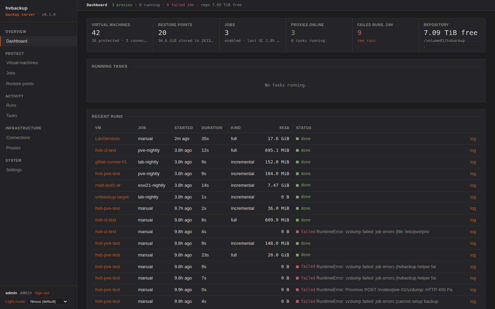

Contents: [What you are installing](#1-what-you-are-installing) ·
[Planning](#2-planning) · [Quick start](#3-quick-start-one-command) ·
[A. Native](#4-native-install-step-by-step) · [B. Docker](#5-docker-compose-install-step-by-step) ·
[C. Debian package](#6-debian-package) · [First run](#7-first-run-walkthrough) ·
[Proxmox VE](#8-proxmox-ve-nodes) · [Proxy VM by hand](#9-installing-a-proxy-vm-by-hand) ·
[CLI](#10-the-cli-on-your-workstation) · [Upgrading, moving, uninstalling](#11-upgrading-moving-and-uninstalling) ·
[Production checklist](#12-production-checklist) · [Troubleshooting](#13-troubleshooting-the-install)

## 1. What you are installing

| Component | Where it runs | What it does |
|---|---|---|
| **Server** | one Linux host (native or Docker) | REST API, web UI, scheduler, catalog (SQLite), the deduplicated chunk repository, TLS |
| **Proxy VM** | one small VM per vSphere cluster or standalone ESXi host | reads snapshot disks that the server hot-adds to it and streams changed blocks to the server; holds no credentials. Deployed from the UI, or installed by hand |
| **Node plug-in** | every Proxmox VE node | a storage plug-in and backup provider installed by a one-liner the server serves; makes the server a Proxmox backup storage |
| **Clients** | anywhere | the web UI in a browser, the `hvbackup` CLI, the vSphere Client plug-in, the Nexus Dashboard plug-in |

Network ports:

| From | To | Port | Why |
|---|---|---|---|
| Server | vCenter and every ESXi host | TCP 443 | vSphere API, snapshot disk reads over HTTPS |
| Server | Proxmox nodes | TCP 8006 | Proxmox API |
| Proxy VMs, Proxmox nodes | Server | TCP 8460 | upload blocks, fetch blocks for restores, agent check-in |
| Browsers, CLI, vCenter (plug-in), dashboards | Server | TCP 8460 | UI and API |
| Proxy VM (during deployment) | Internet or a mirror | TCP 80/443 | Ubuntu apt mirrors and PyPI for the first boot |

## 2. Planning

**Server sizing.** Two vCPUs and 4 GB of RAM are enough for a lab. Backups
through a proxy cost the server little: the proxy hashes and compresses, the
server writes chunks. Backups of powered-off VMs and Proxmox restores run on
the server itself and use one core per concurrent disk. Add a core per
concurrent job you plan to run.

**Repository storage.** Backups land in one directory, `HVB_REPO`, as
content-addressed chunks of 4 MiB compressed with zstd. Any local filesystem
works. ZFS or btrfs are recommended for checksumming; turn their compression
off for the dataset, the chunks are compressed already. NFS works but halves
throughput. Plan for the sum of the allocated size of the VMs you protect,
compressed (typically 40 to 60 percent), plus the daily change rate times the
retention. Identical blocks across VMs and restore points are stored once.

```bash
# ZFS example: a dataset for the repository
sudo zfs create -o compression=off -o atime=off -o mountpoint=/srv/hvbackup tank/hvbackup
```

**Catalog and secrets.** `HVB_DATA_DIR` (default `/var/lib/hvbackup`) holds
the SQLite catalog, the session signing key, the self-signed certificate and
the cached proxy image. It is small (tens of MB plus the 560 MiB image) and it
must persist: without the catalog the chunks are unreadable. Back it up.

**Name and certificate.** Pick the name proxies, nodes and browsers will use
to reach the server, for example `backup.example.net`, and make sure DNS
resolves it from the hypervisor networks. This becomes `HVB_URL`. A
self-signed certificate is generated on first start; the agents and the
Proxmox plug-in pin it by fingerprint, so it works without a CA. The vSphere
Client plug-in and browsers are happier with a real certificate, see
[section 4.6](#46-certificate).

**Accounts.** A vCenter or ESXi account with the privileges listed in the
[README](../README.md#requirements), or an administrator while evaluating. For
Proxmox, `root@pam` or an API token (`user@realm!tokenid`) of a user with the
Administrator role while evaluating.

**Operating system.** Tested on Ubuntu 24.04 and 26.04 and Debian 13. The
native install needs Python 3.12 or newer and systemd. On RHEL 9 the default
`python3` is 3.9: install `python3.12` and make it the default for the
installer, or use Docker.

## 3. Quick start (one command)

`packaging/get.sh` installs the prerequisites, fetches the source and runs the
installer. On a fresh machine, as root:

```bash
git clone https://gitlab.onthenile.net/brainchill/hypervisor-backup-server.git
cd hypervisor-backup-server
sudo ./packaging/get.sh --repo /srv/hvbackup --url https://backup.example.net:8460
```

If the project is reachable without a login you can skip the clone and pipe
the script; it clones into `/opt/hvbackup/src` itself:

```bash
curl -fsSL https://gitlab.onthenile.net/brainchill/hypervisor-backup-server/-/raw/main/packaging/get.sh \
  | sudo bash -s -- --repo /srv/hvbackup --url https://backup.example.net:8460
```

What it does: installs `git`, `python3` and `python3-venv` (apt, dnf or
zypper), runs `packaging/install.sh` with your options, waits for the service
to listen, creates the `admin` account and prints its generated password once.
Set `HVB_ADMIN_PASSWORD` in the environment to choose the password, or run it
from a terminal to be prompted. Run the same command again later to upgrade:
an upgrade never touches accounts or the configuration unless you pass
`--admin` or new values.

| Option | Meaning |
|---|---|
| `--repo DIR` | repository directory; created and owned by the service user |
| `--url URL` | the public URL; default `https://<this host's FQDN>:8460` |
| `--admin NAME` | create or reset this admin account; default `admin` on a first install, nothing on an upgrade |
| `--docker` | Docker Compose instead of native, see [section 5](#5-docker-compose-install-step-by-step) |
| `--agent` | proxy VM: install only the agent |
| `--ref BRANCH\|TAG` | which version to install; default `main` |
| `--source DIR` | use this checkout instead of cloning |

Example run:

```
==> prerequisites
==> source: /opt/hvbackup/src (e8eb210)
==> virtualenv in /opt/hvbackup/venv
==> wrote /etc/hvbackup/hvbackup.conf
==> repository /srv/hvbackup
==> public URL https://backup.example.net:8460
created admin (admin)
==> generated password for admin: 4o4zmuhp6DHxAlWMXPOn   (shown once; change it under Settings)
==> server installed.
    open https://backup.example.net:8460
```

Continue with [section 7, first run](#7-first-run-walkthrough).

## 4. Native install, step by step

### 4.1 Prerequisites

Ubuntu or Debian:

```bash
sudo apt update
sudo apt install -y git python3 python3-venv qemu-utils
```

RHEL, Rocky, Alma 9 or 10:

```bash
sudo dnf install -y git python3.12 python3.12-pip qemu-img
sudo alternatives --install /usr/bin/python3 python3 /usr/bin/python3.12 100   # make 3.12 the default python3
```

`qemu-utils`/`qemu-img` is optional; it enables OVA export of restore points.

### 4.2 Prepare the repository directory

Create or mount the filesystem from [section 2](#2-planning). The installer
creates the directory and gives it to the `hvbackup` user when you pass
`--repo`; if you prepare it yourself, make it writable by that user after the
install:

```bash
sudo chown hvbackup:hvbackup /srv/hvbackup && sudo chmod 750 /srv/hvbackup
```

### 4.3 Get the code

```bash
git clone https://gitlab.onthenile.net/brainchill/hypervisor-backup-server.git
cd hypervisor-backup-server
git checkout main          # or a tag
```

### 4.4 Run the installer

```bash
sudo ./packaging/install.sh --repo /srv/hvbackup --url https://backup.example.net:8460 --admin admin
```

Options: `--repo DIR`, `--url URL`, `--port N`, `--admin NAME` (password from
`HVB_ADMIN_PASSWORD`, a prompt, or generated and printed), `--no-start`
(install but do not start), `--agent` (proxy VM). Without options it writes a
template configuration on a first run and leaves the configuration alone on a
rerun. Every option is idempotent: rerun with new values to change them.

The installer:

1. creates a virtualenv in `/opt/hvbackup/venv` and installs the package from the checkout;
2. creates the system user `hvbackup`, `/etc/hvbackup/hvbackup.conf` (mode 640, group `hvbackup`) and `/var/lib/hvbackup`;
3. applies `--repo`, `--url` and `--port` to the configuration;
4. installs and starts the `hvbackup` systemd unit, then waits until port 8460 answers;
5. creates the admin account when `--admin` is given;
6. links `/usr/local/bin/hvbackup` to the CLI.

### 4.5 What got installed

| Path | Content |
|---|---|
| `/opt/hvbackup/venv` | the Python environment; replaced on upgrade |
| `/etc/hvbackup/hvbackup.conf` | configuration, `KEY=VALUE`; environment variables override it |
| `/etc/systemd/system/hvbackup.service` | the unit: runs as `hvbackup`, `ProtectSystem=full`, writes only under `/var/lib/hvbackup` and the repository |
| `/var/lib/hvbackup` | `catalog.db`, `secret.key`, `certs/`, `images/`, `themes/` |
| `HVB_REPO` | the chunk repository and per-run staging files |
| `/usr/local/bin/hvbackup` | the CLI |

The unit runs with `ProtectSystem=full`, which makes `/usr`, `/boot` and
`/etc` read-only for the service. A repository anywhere else (`/srv`,
`/volume01`, a ZFS mountpoint) needs nothing more than being owned by
`hvbackup`.

### 4.6 Certificate

The server generates a self-signed certificate on first start in
`/var/lib/hvbackup/certs`. To use your own, point the configuration at a PEM
pair the `hvbackup` user can read and restart:

```bash
sudo install -d -m 750 -g hvbackup /etc/hvbackup/tls
sudo install -m 640 -g hvbackup fullchain.pem /etc/hvbackup/tls/cert.pem
sudo install -m 640 -g hvbackup privkey.pem  /etc/hvbackup/tls/key.pem
sudo sed -i 's|^HVB_TLS_CERT=.*|HVB_TLS_CERT=/etc/hvbackup/tls/cert.pem|; s|^HVB_TLS_KEY=.*|HVB_TLS_KEY=/etc/hvbackup/tls/key.pem|' /etc/hvbackup/hvbackup.conf
sudo systemctl restart hvbackup
```

`HVB_URL` must match the certificate's name. After the change, re-run
**Register storage** for each Proxmox cluster: the nodes pin the server's
certificate fingerprint. Proxies deployed while the server was self-signed run
with `HVB_INSECURE=1` and keep working; proxies deployed afterwards verify the
certificate. Hand-installed proxies follow their `agent.conf`.

### 4.7 Firewall

```bash
sudo ufw allow 8460/tcp                      # Ubuntu
sudo firewall-cmd --permanent --add-port=8460/tcp && sudo firewall-cmd --reload   # RHEL
```

### 4.8 Verify

```bash
systemctl status hvbackup
journalctl -u hvbackup -n 20
curl -k -o /dev/null -w '%{http_code}\n' https://localhost:8460/login     # 200
```

Then sign in at `https://backup.example.net:8460` and continue with
[section 7](#7-first-run-walkthrough).

## 5. Docker Compose install, step by step

### 5.1 Prerequisites

Docker Engine with the Compose plug-in (`docker compose version` works). The
image is built locally from the checkout, no registry needed. The container
needs to reach vCenter, ESXi and Proxmox on their ports, and port 8460 must be
published.

### 5.2 Get the code and configure

```bash
git clone https://gitlab.onthenile.net/brainchill/hypervisor-backup-server.git
cd hypervisor-backup-server
cp .env.example .env
```

Edit `.env`:

```
HVB_URL=https://backup.example.net:8460    # the public URL (certificate name, what proxies call back to)
HVB_REPO_HOST=/srv/hvbackup                # host directory for the repository
```

`compose.yml` publishes port 8460, mounts `HVB_REPO_HOST` at
`/var/lib/hvbackup/repo` and keeps the catalog, secrets and certificate in the
named volume `hvbackup-data`.

### 5.3 Build, start, create the admin

```bash
docker compose up -d --build
docker compose exec hvbackup hvbackup init-admin admin
```

Or let the bootstrap do all of it, including `.env`:

```bash
sudo ./packaging/get.sh --docker --repo /srv/hvbackup --url https://backup.example.net:8460
```

### 5.4 Daily operation in Docker

| Task | Command |
|---|---|
| CLI | `docker compose exec hvbackup hvbackup status` (any CLI command, inside the container it needs no token) |
| Logs | `docker compose logs -f` |
| Restart | `docker compose restart` |
| Upgrade | `git pull && docker compose up -d --build` |
| Stop | `docker compose down` (data and repository stay) |
| Back up the catalog volume | `docker run --rm -v hypervisor-backup-server_hvbackup-data:/d -v "$PWD":/b alpine tar czf /b/hvbackup-data.tgz -C /d .` |

The volume name is prefixed with the Compose project name, the directory name
by default; `docker volume ls` shows it.

### 5.5 Your own certificate in Docker

Mount the PEM pair and set the two variables with a Compose override file:

```yaml
# compose.override.yml
services:
  hvbackup:
    environment:
      HVB_TLS_CERT: /etc/hvbackup/tls/cert.pem
      HVB_TLS_KEY: /etc/hvbackup/tls/key.pem
    volumes:
      - /etc/letsencrypt/live/backup.example.net/fullchain.pem:/etc/hvbackup/tls/cert.pem:ro
      - /etc/letsencrypt/live/backup.example.net/privkey.pem:/etc/hvbackup/tls/key.pem:ro
```

`docker compose up -d` picks the override up automatically.

### 5.6 Differences from the native install

- The container runs as root so it can write to any host directory you mount; repository files are owned by root.
- `/var/lib/hvbackup` is the named volume; the proxy image cache (560 MiB) lives there too.
- There is no systemd unit; `restart: unless-stopped` brings the container back after a reboot.
- `qemu-img` is in the image, so OVA export works.
- The Proxmox node plug-in and proxy agent are served by the container like the native server; nothing changes on the hypervisor side.

## 6. Debian package

The package bundles a virtualenv for the Python of the release it is built
on, so build on the same release you install on, or build in a container for
that release:

```bash
packaging/build-deb.sh                        # on this host
packaging/build-deb.sh --docker ubuntu:24.04  # or in a throwaway container
sudo apt install ./dist/hvbackup_*.deb
```

The package installs the same files as [section 4.5](#45-what-got-installed)
and starts the service. Set `HVB_REPO` and `HVB_URL` in
`/etc/hvbackup/hvbackup.conf`, restart, and create the admin:

```bash
sudo systemctl restart hvbackup
sudo -u hvbackup HVB_CONFIG=/etc/hvbackup/hvbackup.conf /opt/hvbackup/venv/bin/hvbackup init-admin admin
```

Installed on a VM where `/etc/hvbackup/agent.conf` already exists, the same
package enables `hvbackup-agent` instead of the server.

## 7. First run walkthrough

Open `https://backup.example.net:8460`, accept the self-signed certificate,
and sign in as the admin.

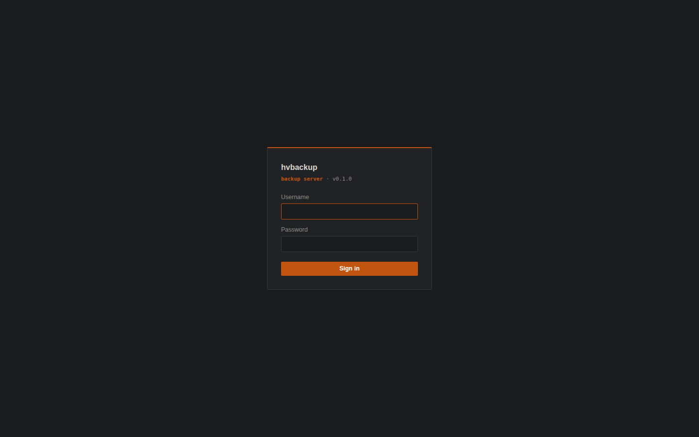

### 7.1 Add a connection

**Connections → Add connection.** Type vCenter, ESXi or Proxmox, host,
username, password. The inventory loads in a few seconds and the VMs appear
under **Virtual machines**.

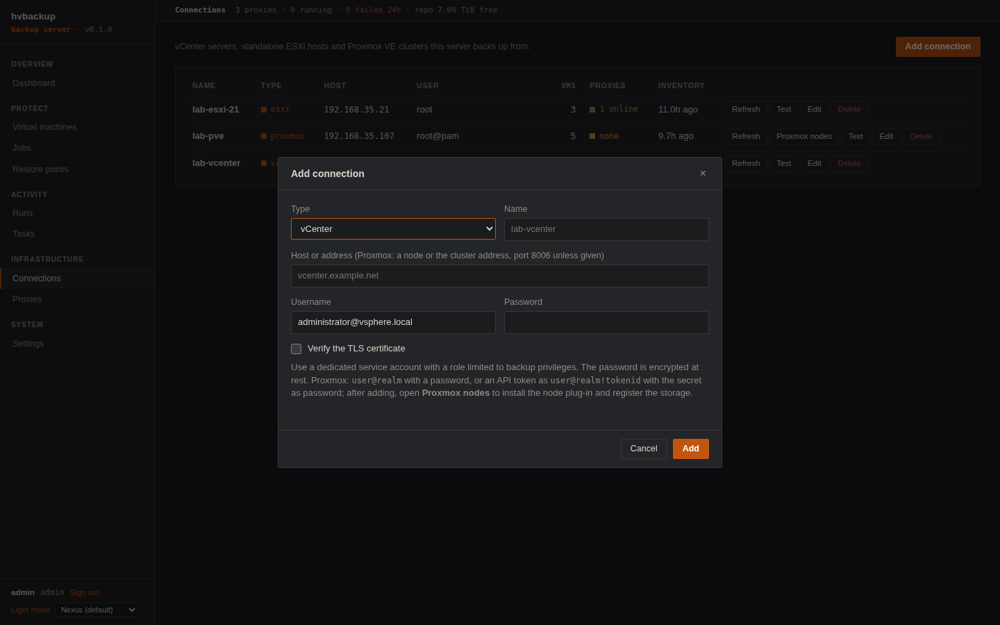

### 7.2 Deploy a proxy VM (vSphere)

Running VMs are read through a proxy VM on the same vSphere. **Proxies →
Deploy proxy VM**: name it, pick the connection, host, datastore and network,
optionally paste an SSH public key, and deploy. The server downloads the
Ubuntu 24.04 cloud image once (checksum verified, cached under the data
directory), imports it, boots it with first-boot data that installs the agent
from this server, and shows the proxy **online** when the agent calls back,
usually within two minutes. The VM needs DHCP, reach to Ubuntu's mirrors and
PyPI, and reach to this server.

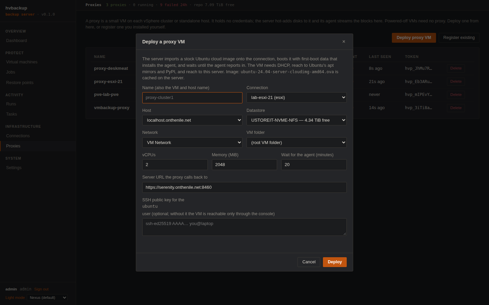

Offline sites set `HVB_PROXY_IMAGE_URL` to a mirror or `HVB_PROXY_IMAGE` to an
OVA already on the server. To install a proxy by hand instead, see
[section 9](#9-installing-a-proxy-vm-by-hand). Powered-off VMs need no proxy.

### 7.3 Back up a VM

**Virtual machines → Backup now** on one VM. The task appears under
**Tasks** with its log; the first run is a full, later runs read only the
blocks vSphere's Changed Block Tracking reports.

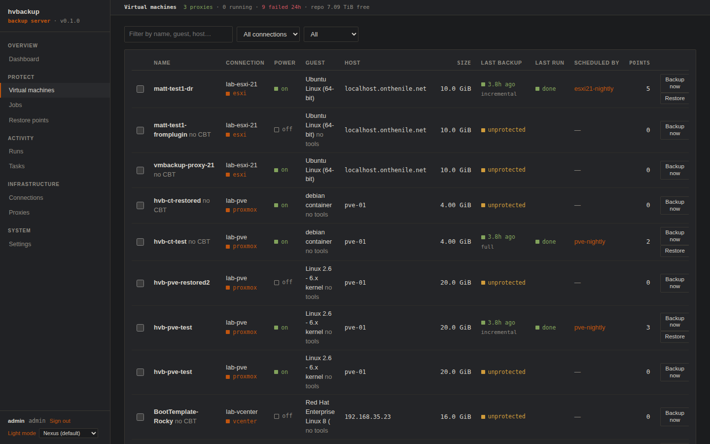

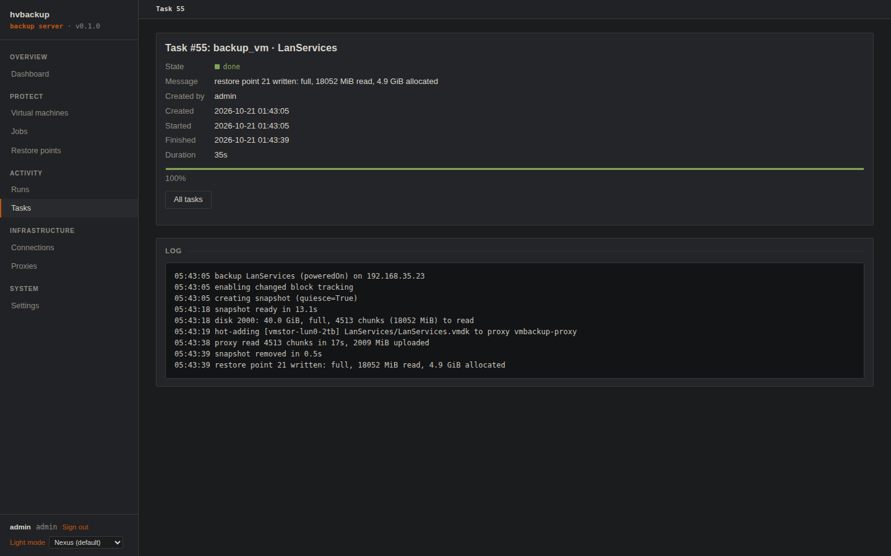

### 7.4 Create a job

**Jobs → New job**: pick the connection and VMs, a cron schedule and the
retention. Jobs run in the scheduler inside the server; nothing else to set
up.

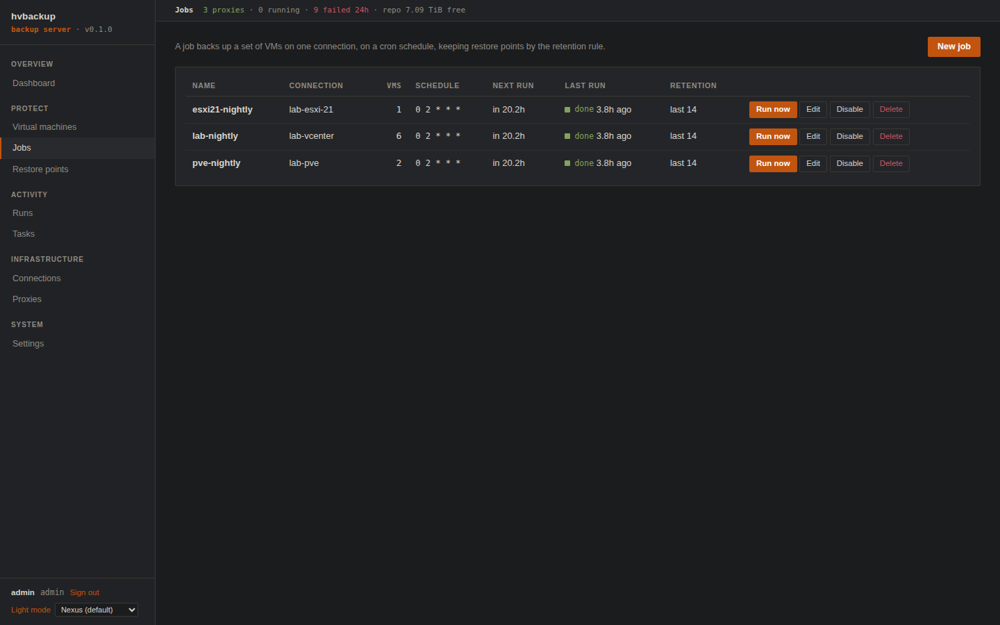

### 7.5 Restore

**Restore points → Restore…** on any point. The dialog defaults to the
source connection and placement; change the connection to restore onto another
vCenter, ESXi host or Proxmox cluster (same platform). Every restore point is
a complete image, so no chain of earlier points is needed.

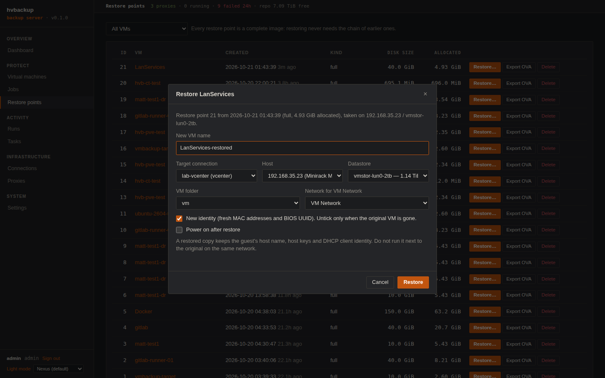

### 7.6 Tokens for clients

**Settings → API tokens** creates tokens for the CLI, the vSphere Client
plug-in and dashboards. See [section 10](#10-the-cli-on-your-workstation).

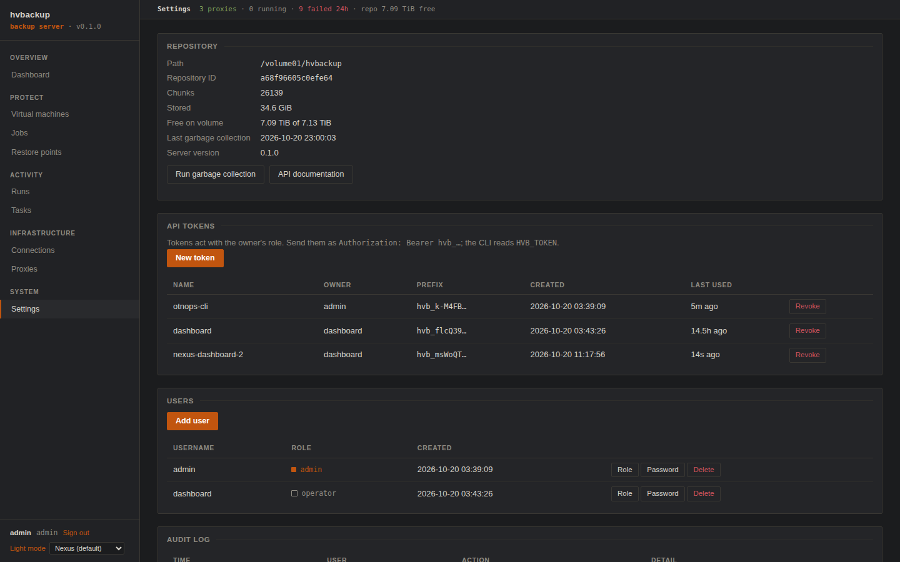

## 8. Proxmox VE nodes

After adding a Proxmox connection, **Connections → Proxmox nodes** shows two
steps:

1. **Install the node plug-in** on every node of the cluster, as root. The one-liner fetches the installer from this server; it installs the storage plug-in and backup provider, a Python helper with its own venv under `/opt/hvbackup`, and `libnbd-bin`, then restarts the PVE daemons. Rerun it to upgrade.
2. **Register the storage.** Creates a storage of type `hvbackup` on the cluster carrying a token for this server and the server's certificate fingerprint.

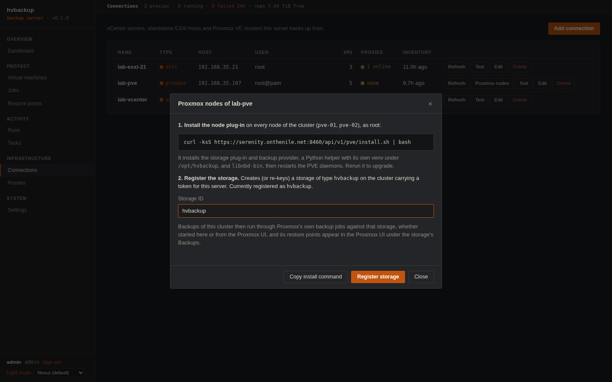

Backups of that cluster then run as Proxmox backup jobs against the storage,
whether started here or in the Proxmox UI, and the restore points appear in
the Proxmox UI under the storage's **Backups**, where they can be restored and
removed.

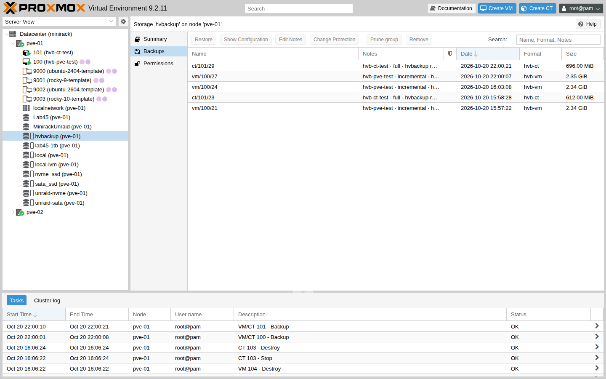

Backup jobs created in the Proxmox UI must have fleecing enabled (Advanced
tab). Jobs started from this server set it automatically.

## 9. Installing a proxy VM by hand

For sites that cannot use the deployment flow, any Linux VM on the cluster
works: 2 vCPU, 2 GB RAM, Python 3.12 or newer, a SCSI controller (ParaVirtual
or LSI Logic), on a host that sees the datastores of the VMs it will back up.

1. **Proxies → Register existing** on the server; name the proxy and pick its connection. The page shows the one-time token and the exact `/etc/hvbackup/agent.conf`.
2. On the VM, as root:

   ```bash
   git clone https://gitlab.onthenile.net/brainchill/hypervisor-backup-server.git
   cd hypervisor-backup-server
   sudo ./packaging/get.sh --agent          # or ./packaging/install.sh --agent
   sudo nano /etc/hvbackup/agent.conf       # paste HVB_URL and HVB_PROXY_TOKEN
   sudo systemctl enable --now hvbackup-agent
   ```

3. The proxy shows **online** within a minute. The server ties it to its VM by BIOS UUID on the next inventory refresh.

Cloning a proxy VM is fine, but give the clone its own `/etc/machine-id`,
fresh SSH host keys and `dhcp-identifier: mac` in netplan before its first boot
on the network, otherwise it takes the original's DHCP lease.

## 10. The CLI on your workstation

The CLI is a client of the API and runs anywhere Python 3.12 is available:

```bash
python3 -m venv ~/.local/hvbackup && ~/.local/hvbackup/bin/pip install git+https://gitlab.onthenile.net/brainchill/hypervisor-backup-server.git
ln -s ~/.local/hvbackup/bin/hvbackup ~/.local/bin/hvbackup
```

Create a token under **Settings → API tokens** and write
`~/.config/hvbackup/client.conf`:

```
HVB_URL=https://backup.example.net:8460
HVB_TOKEN=hvb_...
HVB_INSECURE=1        # or HVB_CA=/path/to/ca.pem
```

```bash
hvbackup status
hvbackup vms list
hvbackup backup <vm> --wait
```

On the server itself the CLI is at `/usr/local/bin/hvbackup`; it still needs a
token, except for the server-side commands `init-admin`, `server` and `agent`.

## 11. Upgrading, moving and uninstalling

| | Native | Docker |
|---|---|---|
| Upgrade | `git pull && sudo ./packaging/install.sh` (or `get.sh` again); the service restarts, config and data stay | `git pull && docker compose up -d --build` |
| Move to another host | stop the service; copy `/var/lib/hvbackup`, `/etc/hvbackup` and the repository; install on the new host; start. The catalog, `secret.key` and the certificate travel together, so proxies and nodes keep working if the URL stays the same | same with the `hvbackup-data` volume and the repository directory |
| Uninstall | `sudo systemctl disable --now hvbackup; sudo rm -rf /opt/hvbackup /etc/systemd/system/hvbackup.service`; remove `/etc/hvbackup`, `/var/lib/hvbackup` and the repository when the backups are no longer needed | `docker compose down -v`; the repository directory is untouched |

Do not restart or upgrade while a backup or restore task runs: tasks die with
the process and the run is marked failed. The dashboard and
`hvbackup status` show running tasks. The catalog schema is extended
automatically on start.

## 12. Production checklist

- `HVB_URL` is the name in DNS and on the certificate; proxies, nodes and vCenter use it.
- A real certificate ([4.6](#46-certificate) or [5.5](#55-your-own-certificate-in-docker)), then `HVB_INSECURE=0` and `HVB_CA` on the clients.
- A dedicated vCenter role with the privileges from the README rather than an administrator.
- The repository on checksumming storage, monitored for free space (the dashboard tile and `hvbackup status --tsv` report it).
- `/var/lib/hvbackup` backed up: the catalog is the index to every chunk.
- Nightly jobs with retention set; garbage collection runs by itself after retention deletes points.
- A restore tested once, onto a scratch network.
- Monitoring: `hvbackup status --tsv` for scripts, the Nexus Dashboard plug-in, or the `failed_runs_24h` field of `GET /api/v1/status`.

## 13. Troubleshooting the install

| Symptom | Fix |
|---|---|
| `python 3.12+ is required` | Install a newer Python (`python3.12` on RHEL 9, then `alternatives`), or use Docker |
| `python3-venv is required` | `apt install python3-venv` |
| `the service did not start` | `journalctl -u hvbackup -n 50`: usually `HVB_REPO` not writable by `hvbackup` or the port in use |
| Service runs but the repository is read-only | The directory is not owned by `hvbackup`, or it sits under `/etc` or `/usr`, which the unit mounts read-only |
| `curl … get.sh` returns an HTML login page | The project is private; clone with credentials and run `./packaging/get.sh` from the checkout |
| Browser warns about the certificate | Expected with the generated certificate; install your own ([4.6](#46-certificate)) |
| Proxy deployment fails with `the agent has not reported in` | The VM could not reach apt, PyPI or `HVB_URL`; read `/var/log/hvbackup-bootstrap.log` on its console |

For everything after the install, see the troubleshooting table in the
[README](../README.md#troubleshooting).
